# ErgoCheck: assessments admin

A multi-tenant console where a company's admins review their employees' ergonomic and health assessments and export them safely.
It is my answer to OfferZen's *"Safely extending a legacy Rails feature"* take-home: three targeted changes to an old Rails app,
made with restraint and without rewrites.

| | |
|---|---|
| **Live app** | <https://web-production-f3e069.up.railway.app/> (sign in with a [demo account](#try-it)) |
| **Design, trade-offs, measurements, release and rollback plan** | [`SOLUTION.md`](SOLUTION.md) |
| **How AI tools were used** | [`SOLUTION.md` §17](SOLUTION.md#17-how-i-used-ai-tools) |
| **Video walkthrough** | linked in the submission e-mail |

**Contents:** [What was asked](#what-was-asked-and-what-you-get) · [Try it](#try-it) · [Architecture](#architecture) ·
[Is it fully functional?](#is-it-fully-functional) · [Run it locally](#run-it-locally) · [Hosting on Railway](#hosting-on-railway) ·
[Where things live](#where-things-live)

**Stack:** Ruby 3.3 · Rails 8.1 · PostgreSQL · Inertia.js 3 · React 19 · TypeScript (strict) · Vite 8 · Tailwind CSS 4 ·
Active Storage · Solid Queue · Minitest. Fonts are self-hosted (Instrument Sans and Serif, IBM Plex Mono).

## What was asked, and what you get

| Task | What you get | How it was checked |
|---|---|---|
| **1. Company-scoped CSV export** | Export your own company's assessments with exactly two filters (date range, status), built in the background. Six columns; personal identifiers and free-text answers never leave the system. | Tenant tests that send a rival company id; a test that reads the SQL to prove names are never loaded; the real file inspected for e-mail addresses (zero). |
| **2. A faster dashboard with a correct score** | Two queries per page (one grouped count, one page of ten rows), two measured indexes, one score rule, and request logs that no longer carry health data. | **94.5 s and 300,001 queries before, 23 ms and 2 queries after**, on a 300,000-assessment company; a query-count test keeps it at two. |
| **3. Status normalization** | New and updated records only ever hold `pending`, `in_progress`, `completed`, `needs_follow_up` or `archived`. The historical backfill is **designed, tested and guarded, but not executed**, with an eight-step release plan and rollback ladder. | A test proves the SQL mapping agrees with the Ruby one on awkward input; the backfill's rollback keeps later edits. |

**Improvements that follow from the tasks:**

- an **export audit trail** (who requested each export, how often it was downloaded) with **a link of its own on every export and a live countdown to when it expires**. The link opens only for admins of the company that owns it; anyone else gets a designed 404;
- a **legacy-data note** (how much of the history still uses old status spellings, shown instead of hidden);
- **search** (by employee, department or assessment code), company-scoped, never logged, never part of an export;
- a **redesigned interface** (floating navigation, a design system in tokens, mobile-first sheets, a snow-white canvas);
- an optional **assistant** ("Ask in plain English"), off unless you set a key, that can only set filters or propose an export.

Plus three extras beyond the brief: a **self-hosted CAPTCHA** on sign-in, **cookie consent**, and a small **New assessment** form so the app can be explored end to end.
How I approached a ten-year-old application, how I would upgrade one, and what I would build next are in `SOLUTION.md` (§1.1, §13 to §16).

## Try it

### The live app

Open <https://web-production-f3e069.up.railway.app/> and sign in with any account below. The hosted copy holds only fictional demo data.

### Demo accounts

After `bin/rails db:setup` (or `bin/rails db:seed`) these four company admins exist. **They all share one password.**

| Email | Company | Data |
|---|---|---|
| `maya.reyes@northwind.example` | Northwind Logistics | 64 assessments (the design's dataset, with legacy-messy statuses) |
| `daniel.osei@northwind.example` | Northwind Logistics | the same company as Maya, a second admin |
| `jonas.weber@harborpine.example` | Harbor & Pine Clinics | 24 assessments, clean |
| `aisha.bello@summitphysio.example` | Summit Physio Group | 40 assessments (messy again) |

**Password: `ergocheck-demo-2026`.** Set `DEMO_ADMIN_PASSWORD=...` before seeding to change it. For a real deployment always do; the live demo deliberately keeps these fictional accounts so reviewers can sign in. Seeding again re-applies the configured password to these four accounts.

**Signing in has three parts:** email, password, then the **verification**: a real self-hosted CAPTCHA, five digits in an image. If you cannot read it, click *Can't see the image? Use a text question instead* and answer the sum (for example "What is 36 minus 25?"). A wrong code is rejected even with the right password, and every challenge works once.

### A two-minute tour

1. **Two companies, two datasets.** Sign in as Maya (Northwind): the page says *Showing your company only* and shows 64 assessments with a *Data tidiness* note ("42 of 64 use a standard status"). Sign out and sign in as Jonas (Harbor & Pine): 24 clean assessments, no note. The company comes from your session, never from a parameter.
2. **The dashboard.** Search "priya", click **Completed**, open a row (the URL carries `?selected=`), change its status and watch the chips and score react. A pending row says *Not scored yet*.
3. **An export, and its link.** As Maya press **Export CSV**, request it, then open **Exports**. Under the row you see the export's **own link** with a **Copy** button and **"Expires in 23h 5Xm …"** counting down.
4. **The link belongs to the company.** Click **Copy**, sign out, sign in as **Jonas**, and paste the link into the address bar: **a 404**. Daniel (same company as Maya) can use it; Jonas (another company) cannot, even holding the exact link.
5. **The plan.** Open **Release plan** (type `comp`, `n/a`, `xyz` into the tester) and **Safeguards** (the log line before and after filtering).

## Architecture

### The big picture

One Rails app, one deployable. The browser talks to Rails through Inertia (no separate API); everything else lives in the one PostgreSQL database.

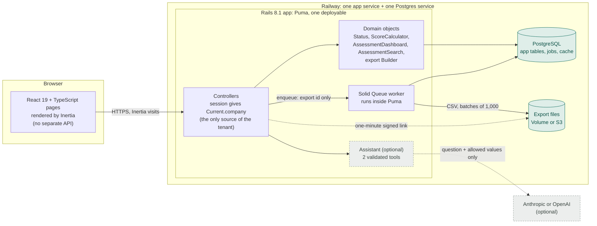

### One request, end to end

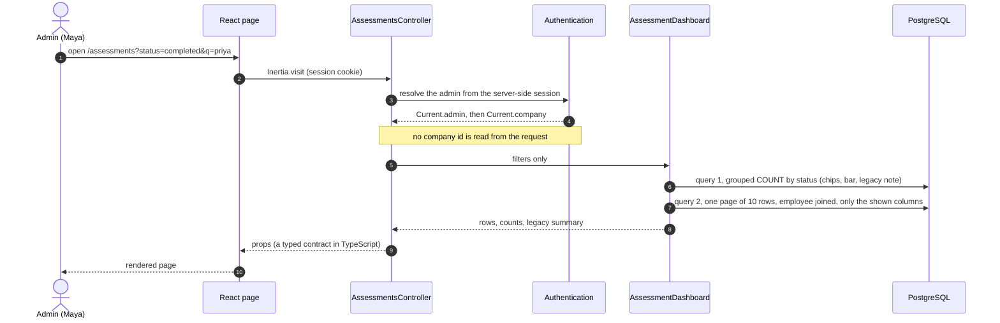

### The one rule that matters: the tenant comes from the session

`Current.company` is derived from the signed-in admin, and every query goes through `Current.company.<association>`. A `company_id` parameter is not read anywhere, so there is nothing for a client to forge. Another company's record is a **404, not a 403**, so the response does not even confirm that it exists.

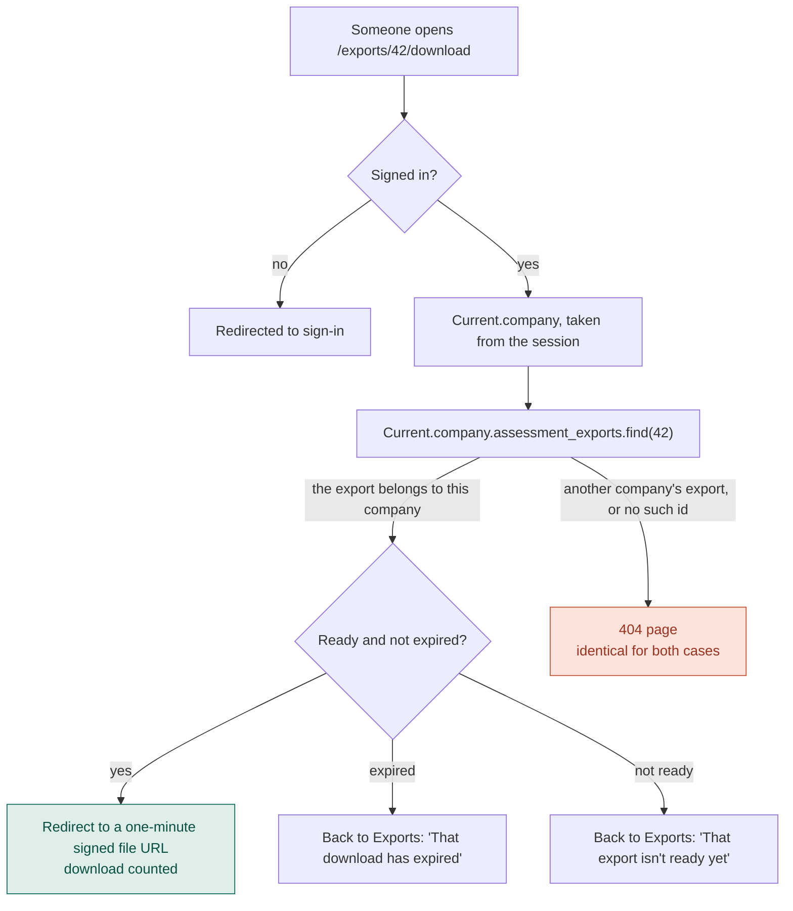

### An export, from request to expiry

A background job rather than streaming: a large export can outlast a web request, and a restart should not lose it ([`SOLUTION.md` §4.1](SOLUTION.md#41-async-not-streaming--and-why)).

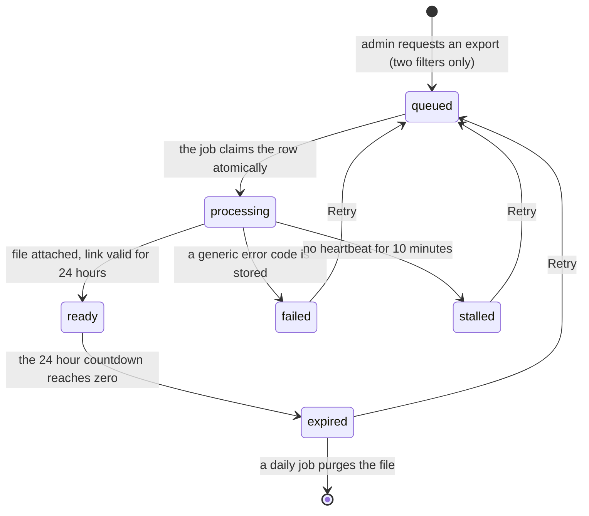

Every row on the Exports page carries its own link and, once the file is ready, a countdown. The server sends the time left as a **duration** (`expires_in`), so a wrong clock on the admin's computer cannot shift it, and the browser counts on its own timer.

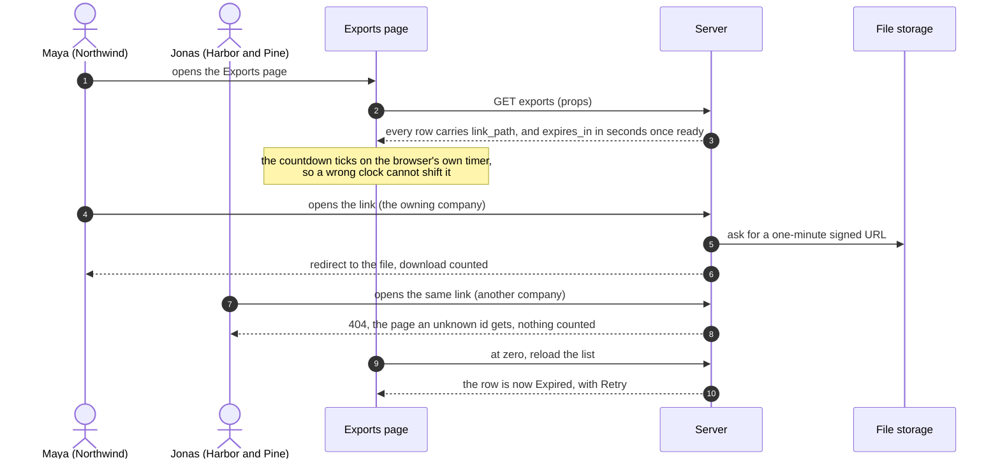

**What is in the file:** `assessment_id, employee_ref, department, status, score, created_at`.
**What is never in it:** names, e-mail addresses, free-text answers, raw responses. Employees appear as a one-way HMAC reference such as `emp_a41f9c02d7e1`.
The export reads those six columns through a dedicated `SELECT`, so sensitive columns are never loaded: redaction by construction, not by filtering.

### Data model

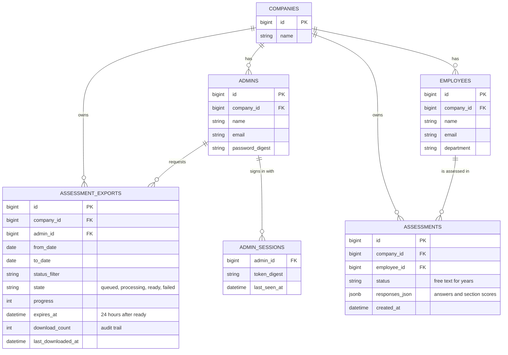

`assessments.status` is a free string with years of inconsistent values: the legacy rough edge the brief describes. Reads fold old spellings through `Status.classify`; writes go through `Status.normalize`.
Indexes: `(company_id, created_at DESC, id DESC)` orders the page, `(company_id, status, created_at DESC)` answers the status counts. Also in the database: a one-use `captcha_challenges` table, and Solid Queue and Solid Cache tables.

### Statuses: one definition, used everywhere

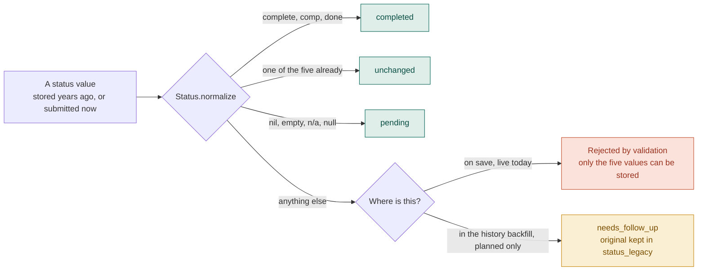

The historical clean-up is an eight-step release plan; green steps are safe while the app is live, amber steps are for a low-traffic window. The full plan, backup and rollback ladder are in [`SOLUTION.md` §6](SOLUTION.md#6-task-3--normalizing-statuses-with-a-safe-release-plan).

```mermaid
flowchart LR
  s1["1. Backup<br/>and prove it restores"] --> s2["2. Deploy the<br/>write-path normalizer"]
  s2 --> s3["3. Add status_legacy<br/>nullable, metadata only"]
  s3 --> s4["4. CHECK constraint<br/>NOT VALID"]
  s4 --> s5["5. Backfill in batches<br/>of 5,000, resumable"]
  s5 --> s6["6. VALIDATE the<br/>constraint"]
  s6 --> s7["7. Dashboard indexes<br/>CONCURRENTLY"]
  s7 --> s8["8. Drop status_legacy<br/>after 14 stable days"]

  classDef live fill:#dfeee9,stroke:#0e6b5c,color:#0a4f44
  classDef window fill:#fbefd3,stroke:#c98a12,color:#7a4e00
  class s1,s2,s3,s5,s6,s7 live
  class s4,s8 window
```

### Why it is shaped this way

- **Inertia, not a separate SPA and API.** One repository, one deploy, one set of auth and CSRF rules. Controllers return page props; React renders them, and an old page and a new page can live in the same app, so a legacy UI can be modernised page by page. TypeScript sits where it adds value: the contract between server and page.
- **Plain Ruby objects for the domain.** `Status`, `ScoreCalculator`, `AssessmentDashboard`, `AssessmentRow`, `NewAssessment` and the export builder are small, individually tested classes. Controllers only translate HTTP to and from them.
- **Background export, not streaming.** A queued row plus a job gives progress, retry and a stored file, and never holds a web thread.
- **Jobs live in the same Postgres.** Solid Queue and Solid Cache use tables in the one database, so a deployment needs only Postgres (no Redis).
- **Restraint.** No rewrite, no new framework, no new infrastructure. Anything beyond the brief is flagged as such.

### Cookies

| Cookie | Purpose | Consent |
|---|---|---|
| `_ergocheck_session` | keeps you signed in (encrypted, HttpOnly, SameSite=Lax, Secure in production) | strictly necessary |
| `XSRF-TOKEN` | CSRF protection for in-page requests | strictly necessary |
| `ergocheck_consent` | remembers your choice (signed, 12 months) | strictly necessary |
| `ergocheck_prefs` | remembers the dashboard status filter and date preset (signed, 90 days) | **only with your opt-in** |

The banner offers *Accept all*, *Essential only* or *Customize*; **Cookie settings** in the account menu (the round initials button, top right) reopens it. Withdrawing consent deletes `ergocheck_prefs` immediately. The "release steps" ticks on the Release plan page use `localStorage` and are likewise remembered only if you opted in.

## Is it fully functional?

**Yes, for what the brief and the design describe.** Every screen works against a real database; nothing is mocked.

| Area | What works |
|---|---|
| Sign-in / sign-out | Password + CAPTCHA, server-side sessions that expire after 8 idle hours, rate limits, one generic error message |
| Dashboard | A status bar and chips with live counts, 7/30/90-day and custom date filters, paging, a detail drawer (`?selected=`) with a five-way status chooser, the score and its four sections |
| Change status | From the drawer. Aliases such as `comp` are normalized, unknown values are rejected, and the counts and score update immediately |
| **New assessment** | Pick one of your employees or add one, choose a status, optionally enter the four section scores. Saved to your company only |
| CSV export | Live match count, background build with real progress, ready / failed / expired states, retry, one-minute signed download. Six columns, no personal data |
| Exports page | History of the company's exports and their state, who requested each one, how often it was downloaded, and on every row the export's own link (Copy) with a live countdown to when it expires. Another company opening that link gets a 404 |
| Search | By part of an employee's name, a department or an `A-` code; several words at once; `/` or Cmd/Ctrl+K to focus it. Counts, pager and the legacy note follow the search; it is never logged, never remembered and never part of an export |
| Ask in plain English | Optional (see [The assistant](#the-assistant-optional)): a sentence becomes filters, or an export you review and confirm. Hidden unless configured |
| Legacy-data note | Under the filters: "42 of 64 use a standard status" with a progress bar, which older spellings were found and how they are shown. Hidden when the data is clean |
| Cookies | Consent banner, *Cookie settings*, an optional cookie only after opt-in |
| Release plan and Safeguards | Internal pages: the status mapping with a live tester, the eight release steps, and the log-filtering proof |

**Deliberately not included** (outside the brief, which asks for restraint): self-service sign-up, password reset and e-mail (there is no mailer), admin management, editing or deleting employees and assessments (an assessment is retired by setting it to *Archived*), and running the historical status backfill (the brief says *plan only*). Admin accounts are provisioned (the seeds do it).

**Why not Devise?** Sign-in is a small custom layer on Rails' own tools: `has_secure_password` (bcrypt) plus server-side `admin_sessions` rows. The app needs no sign-up, confirmation, reset or lockout flows, so Devise's modules would be unused surface, and the CAPTCHA, the revocable sessions and the per-account throttle all had to be custom anyway. The cost is real: if the product later needs password reset or 2FA, adopting Devise (or the Rails authentication generator's reset flow) is the sensible next step. Details in [`SOLUTION.md` §7](SOLUTION.md#7-sign-in-captcha-and-cookies).

## Run it locally

**Prerequisites:** Ruby 3.3.12, Node.js 22.12 or newer, PostgreSQL 14 or newer (running, with a role that can create databases).

```bash
bundle install
npm install
bin/rails db:setup      # creates the databases, loads the schema, seeds the demo companies
bin/dev                 # Rails on :3000 plus the Vite dev server on :3036
```

Open <http://localhost:3000> and sign in with an account from [the table above](#demo-accounts). `db:setup` prints the accounts again; so does `bin/rails db:seed` at any time (it never duplicates anything).

**Port 3000 already used?** Pick another one; Rails follows `PORT`:

```bash
PORT=4000 bin/dev                          # open http://localhost:4000
PORT=4000 VITE_RUBY_PORT=3046 bin/dev      # also move Vite, if 3036 is taken too
```

In development, background jobs run in-process, so exports finish without a separate worker.

| If you see | Do this |
|---|---|
| `Address already in use`, or the page is another app | something else is on port 3000: `PORT=4000 bin/dev` |
| a blank page, or the console cannot reach `localhost:3036` | start with `bin/dev` (not `bin/rails server` alone), or move Vite: `VITE_RUBY_PORT=3046 bin/dev` |
| `PG::ConnectionBad`, `connection refused`, `role does not exist` | PostgreSQL is not running (Homebrew: `brew services start postgresql@<version>`), or your role cannot create databases |
| `bundle install` fails on `pg` | install the client headers: `brew install libpq`, or `libpq-dev` on Debian/Ubuntu |
| the dashboard looks empty | a remembered filter may be applied (press **Clear filters**), or the database is empty (`bin/rails db:seed`) |
| "the verification did not match" | each code is single-use and expires in five minutes: type the current image's digits, or use the text question |
| "too many attempts" | rate limits protect sign-in (10 tries per address per 3 minutes, 6 per account per 10 minutes): wait a few minutes |
| an export stays *Building* | in production the job worker must run: `SOLID_QUEUE_IN_PUMA=1`, or `bin/jobs` as a separate process; a stuck export is marked stalled after 10 minutes and can be retried |

### The assistant (optional)

*Ask in plain English* turns a sentence such as "completed in Warehouse, last 30 days" or "export September" into the dashboard's own filters, or into an export you still review and confirm. It is **off unless you configure it**, so nothing changes for anyone who does not want it.

```bash
ANTHROPIC_API_KEY=sk-ant-...   bin/dev     # or OPENAI_API_KEY=sk-...   (ASSISTANT_PROVIDER and ASSISTANT_MODEL are optional)
ASSISTANT_PROVIDER=rules       bin/dev     # no key: a few plain rules, no AI, nothing leaves the server
```

To run locally with the same variables you set on the hosting platform, put them in a git-ignored `.env` file at the project root (`.env.example` lists them all): `bin/dev` loads it, so the assistant behaves the same locally as when deployed. Restart `bin/dev` after changing it. Never commit a key.

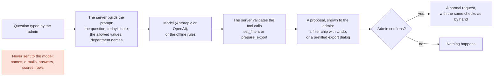

It is deliberately narrow, because the data is health data: it cannot read data, write data or create an export, and everything it returns is validated; the question is filtered from the logs. The provider calls are tested against a stand-in for the network; the **Anthropic** call was also tried by hand against the live API (two questions, see `SOLUTION.md` §14) and the **OpenAI** call has **not** been run live; the offline mode was exercised end to end.

### Quality gates

All of these are expected to be clean:

```bash
bin/rails test           # 355 tests: tenancy, redaction, filters, score, status, backfill, auth, sessions, CAPTCHA, cookies, logs, export links, new assessment, rate limits, production config
bin/rubocop              # style
bin/brakeman             # static security analysis
bin/bundler-audit        # Ruby dependency advisories
npm run check            # TypeScript (strict)
npm audit                # JavaScript dependency advisories
bin/ci                   # all of the above in one go
```

### Measure the dashboard yourself

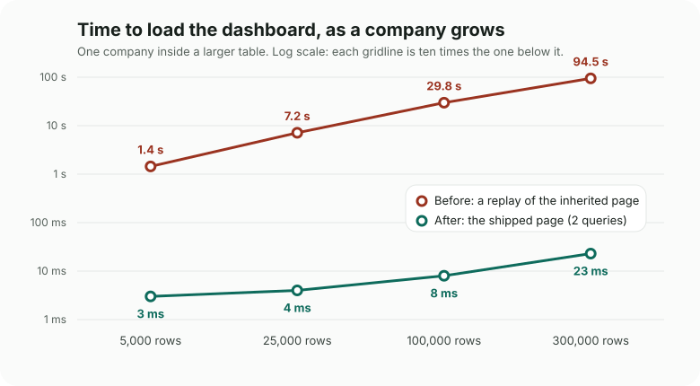

```bash
SIZES=5000 bin/rails perf:report     # seed and benchmark one size in about 3 seconds
bin/rails perf:seed ROWS=100000      # one big tenant plus other tenants (3x as many rows)
bin/rails perf:benchmark             # legacy-style page vs the current one, with and without the indexes
bin/rails perf:explain               # EXPLAIN ANALYZE of the SQL the page really runs
bin/rails perf:clean                 # remove the benchmark data
```

Large sizes are slow because the *old* page is slow: replaying it makes one query per row, which is minutes at 400,000 rows. To measure only the current page at a big size, leave that out:

```bash
SIZES=700000 LEGACY=skip INDEXES=shipped bin/rails perf:report   # about a minute; progress prints to stderr
```

My own run is committed in [`benchmarks/`](benchmarks/dashboard-2026-10-10.txt) and summarised in `SOLUTION.md` §5.3.

### The status backfill (plan only)

```bash
bin/rails status:backfill:report                 # read-only audit: safe at any time, even on production
bin/rails status:backfill:run CONFIRM=yes        # guarded; needs the status_legacy column (release step 3)
bin/rails status:backfill:rollback CONFIRM=yes   # restores the original values
```

The write tasks refuse to run without `CONFIRM=yes`, without the prerequisite column, and in production without `BACKUP_TAKEN=yes`. This repository never runs them against real data.

## Where things live

| Area | Files |
|---|---|
| Tenancy and auth | `app/models/current.rb`, `app/controllers/concerns/authentication.rb`, `app/controllers/sessions_controller.rb` |
| CAPTCHA | `app/models/captcha.rb`, `app/models/captcha/renderer.rb`, `app/controllers/captchas_controller.rb` |
| Cookies | `app/models/cookie_preferences.rb`, `app/controllers/cookie_consents_controller.rb`, `app/javascript/components/CookieConsent.tsx` |
| Statuses | `app/models/status.rb`, `app/models/assessment.rb`, `app/models/status_backfill.rb`, `lib/tasks/status.rake`, `db/release_plan/` |
| Dashboard | `app/models/assessment_dashboard.rb`, `assessment_row.rb`, `score_calculator.rb`, `app/javascript/pages/assessments/` |
| Search | `app/models/assessment_search.rb`, `AssessmentDashboard`, `app/javascript/components/assessments/SearchField.tsx`, `Highlight.tsx` |
| Assistant | `app/models/assistant.rb`, `app/models/assistant/` (agent, tools, clients), `app/controllers/assistants_controller.rb`, `AskAssistant.tsx` |
| Design system and layout | `app/javascript/entrypoints/application.css` (tokens), `layouts/`, `components/ui.tsx`, `components/Dialog.tsx` |
| New assessment | `app/models/new_assessment.rb`, `AssessmentsController#create`, `app/javascript/components/assessments/NewAssessmentDialog.tsx` |
| Export | `app/models/assessment_export.rb`, `app/models/assessment_exports/`, `app/jobs/`, `app/controllers/exports_controller.rb`, `app/javascript/components/exports/` (including `ExportLink.tsx` and `Countdown.tsx`) |
| The 404 page | `public/404.html`, rendered by `ApplicationController` for any missing or foreign record |
| Performance | `db/migrate/*_add_assessments_dashboard_indexes.rb`, `lib/tasks/perf.rake`, `benchmarks/` |
| Logging | `config/initializers/filter_parameter_logging.rb`, `test/integration/log_hygiene_test.rb` |
| Deployment | `Dockerfile`, `config/puma.rb`, `Procfile`, `app.json`, `bin/docker-entrypoint` |

## Hosting on Railway

The app is set up to be hosted on [Railway](https://railway.com) as **one app service plus one PostgreSQL service**; the live app above runs this way. Everything you need is on this page.

> **What is and is not verified.** A first live deploy found three real problems, each now fixed and covered by a test (a commented-out `production:` block in `config/database.yml`, a web process that started against an empty database, and a seed gate that silently skipped the demo accounts). The same commands Railway runs were also exercised locally in production mode: release build, `db:prepare db:seed`, `bin/rails server -b ::`, the job worker inside Puma, an export built and downloaded, the health check answering on IPv4 and IPv6. **Not verified:** the Docker build itself (no Docker where this was written), and export storage on a Railway volume or in S3 (S3 is exercised with a stubbed client only, see "Where export files are stored").

### How it is hosted

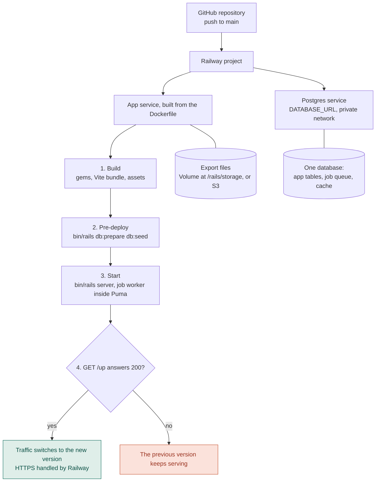

- **One service runs everything.** Puma serves the app and, with `SOLID_QUEUE_IN_PUMA=1`, also runs the job worker that builds CSV exports. Jobs, cache and app data share the one Postgres, so there is no Redis to host.
- **The database is prepared twice, on purpose.** Railway's pre-deploy command runs `db:prepare db:seed` before the new version starts, and `config/puma.rb` runs the same thing when the web process boots in production, because a custom start command can bypass the pre-deploy step. It is idempotent and takes about a second when there is nothing to do; `SKIP_DB_PREPARE=1` turns the boot-time run off.
- **The health check protects each deploy.** Railway calls `/up` (from the host `healthcheck.railway.app`, which the app does not filter) and only switches traffic over once it answers with a success status.
- **HTTPS is terminated by Railway.** The app trusts that (`assume_ssl`), forces secure cookies, and sends a strict Content-Security-Policy.
- **Secrets stay out of the repository.** Everything below is set as Railway variables, never committed.
- **There is no `railway.json`.** Railway's Settings page says "Config as Code is deprecated … Starting 2026-08-28, services that have never used Config as Code cannot opt in", so for a new service such a file is not read. The values are set on the service's Settings page instead (next table).

### Service settings

| Setting (service → Settings) | Value |
|---|---|
| Builder | Dockerfile (the box may say Railpack by default; choose Dockerfile) |
| Pre-deploy command | `bin/rails db:prepare db:seed` |
| Custom start command | `bin/rails server -b ::` (or leave empty; the Dockerfile's default does the same) |
| Healthcheck path | `/up` |
| Networking | Generate Domain; leave the port to Railway, which provides `PORT` (8080 in real logs) and Puma listens on it |

### The variables

Set them on the **app service → Variables** (the **Raw Editor** pastes them in one go). `Postgres` in the first line must match the exact name of your database service.

```dotenv
DATABASE_URL=${{Postgres.DATABASE_URL}}
SECRET_KEY_BASE=<output of: bin/rails secret>
SOLID_QUEUE_IN_PUMA=1
ALLOW_DEMO_SEED=true
DEMO_ADMIN_PASSWORD=<a long password you choose>
SHOW_OPS_PAGES=true
RAILWAY_RUN_UID=0
```

| Variable | Needed | What it does, and what happens without it |
|---|---|---|
| `DATABASE_URL` | **yes** | How the app finds Postgres. Without it the app stops at boot with `DATABASE_URL is not set` and the fix in the message. |
| `SECRET_KEY_BASE` | **yes** | Signs and encrypts cookies and signed links, and seeds the one-way `emp_…` references. Changing it later signs everyone out and changes the references in future exports. |
| `SOLID_QUEUE_IN_PUMA` | **yes** | Runs the job worker inside the web process. Without it the app works, but exports stay "Building" forever. |
| `ALLOW_DEMO_SEED` | for a demo | Lets `db:seed` create the demo companies and admins in production. `true`, `1`, `yes` or `on` (any case; spaces and quotes ignored) turn it on; otherwise nothing is created, and the deploy log says what the variable contained. |
| `DEMO_ADMIN_PASSWORD` | **yes** with `ALLOW_DEMO_SEED` | The password of the four demo admins (12 or more characters). While the seed is allowed, every boot re-applies it, so changing the variable and redeploying changes the password. If it is blank, the public default from this README is used, so always set it. It is never printed in a log. |
| `SHOW_OPS_PAGES` | optional | Shows the internal *Release plan* and *Safeguards* pages (404 in production otherwise). |
| `RAILWAY_RUN_UID` | with a Volume | The image runs as a non-root user, which cannot write to a freshly mounted volume; Railway's documented fix is to run as root. |
| `EXPORT_MAX_SECONDS` | optional | How long an export may run before it fails with "try a narrower range" (default 300). |
| `ANTHROPIC_API_KEY` or `OPENAI_API_KEY` | optional | Turns on the assistant (see [The assistant](#the-assistant-optional)). Without one the assistant does not exist. Set it as a Railway variable, never in the repository. |
| `RAILS_LOG_LEVEL` | optional | `info` by default. Never `debug` in production: it logs SQL and parameters for health data. |

`RAILS_ENV=production` is already set inside the Dockerfile.

### Where export files are stored

An export is a CSV written through Active Storage. A Railway container's disk is wiped on every deploy, so choose one:

- **A Volume (simplest).** Create one (⌘K, or right-click the canvas), attach it to the app service, set its mount path to `/rails/storage`, and keep `RAILWAY_RUN_UID=0`. Railway allows one volume per service, such a service cannot have replicas, and redeploying it causes a short downtime.
- **Amazon S3.** Create a private bucket and a key that can use only that bucket, then set `ACTIVE_STORAGE_SERVICE=amazon`, `AWS_S3_BUCKET`, `AWS_ACCESS_KEY_ID`, `AWS_SECRET_ACCESS_KEY` and `AWS_REGION` (default `eu-west-1`). The service is defined in `config/storage.yml` and `test/s3_storage_test.rb` proves, offline with the AWS SDK's stubbed client, that it reads those variables, keeps files private, hands out 60-second signed links and stores a real export; it has **not** been run against a real bucket. Railway's own Buckets or Cloudflare R2 need a custom endpoint, which this configuration does not offer.

### Deploy in seven steps

1. **Push this repository to GitHub.**
2. In Railway: **New Project → Deploy from GitHub repo**, pick the repository. The first deploy stops with a missing-secret error until step 4. That is expected.
3. **Add the database:** **New → Database → Add PostgreSQL**.
4. Open the app service → **Variables** and add the variables above.
5. **Storage:** attach a Volume at `/rails/storage` (or set the S3 variables instead).
6. **Settings:** check the table above, in particular the pre-deploy command, the Dockerfile builder and the `/up` health check.
7. **Settings → Networking → Generate Domain**, open it, and sign in with a [demo account](#demo-accounts).

**Changing or rolling back:** pushing to the connected branch deploys again. To go back, open the service's **Deployments** list, use the menu on an earlier deployment and choose **Rollback** (it restores the image and the variables).

**The brief's release plan is written for a "Heroku-like" platform** (`heroku pg:backups`, `heroku run`). On Railway the same plan applies: take the backup with `pg_dump` against the database's connection string (enable the Postgres service's *Public Access* to reach it from your machine), restore it into a scratch database to prove it, and run the rake tasks inside the deployed service with `railway ssh`. A Heroku `Procfile` and `app.json` are included too.

### If something goes wrong

| What you see | Cause | Fix |
|---|---|---|
| ``DATABASE_URL is not set`` (older builds: ``The `production` database is not configured``) | the variable is missing, or the reference names a service that does not exist | add `DATABASE_URL=${{Postgres.DATABASE_URL}}`, with the name exactly as your Postgres service, and redeploy |
| ``relation "solid_queue_recurring_tasks" does not exist`` and Puma stops | the database was empty and nothing created the tables | fixed in `config/puma.rb`, which prepares the database at boot; make sure `SKIP_DB_PREPARE` is not set |
| "We couldn't sign you in with those details" with the right password and a correct CAPTCHA | no demo accounts exist (`ALLOW_DEMO_SEED` is not one of `true`, `1`, `yes`, `on`; the deploy log says `Skipping demo data`), or `DEMO_ADMIN_PASSWORD` is not what you are typing | set both variables and redeploy; every deploy re-applies the password |
| Exports stay "Building" | `SOLID_QUEUE_IN_PUMA` is not set | set it to `1` and redeploy |
| An export finishes but the download fails, or files disappear after a deploy | the files are on the container's disk | attach a Volume or use S3 (above) |
| The deploy is marked failed at the health check | the Healthcheck path is not `/up`, or the app crashed at boot | read the deploy log; the first error is the cause |
| *Release plan* and *Safeguards* give a 404 | they are hidden in production | set `SHOW_OPS_PAGES=true` |

## How AI tools were used

I used Claude, through its coding agent Claude Code, while building this: to diagnose the N+1 query behind the slow dashboard, for the UI design, for the documentation, and, under my direction, for much of the implementation and the tests. [`SOLUTION.md` §17](SOLUTION.md#17-how-i-used-ai-tools) says where it helped, how I checked its work, and where it was wrong.
